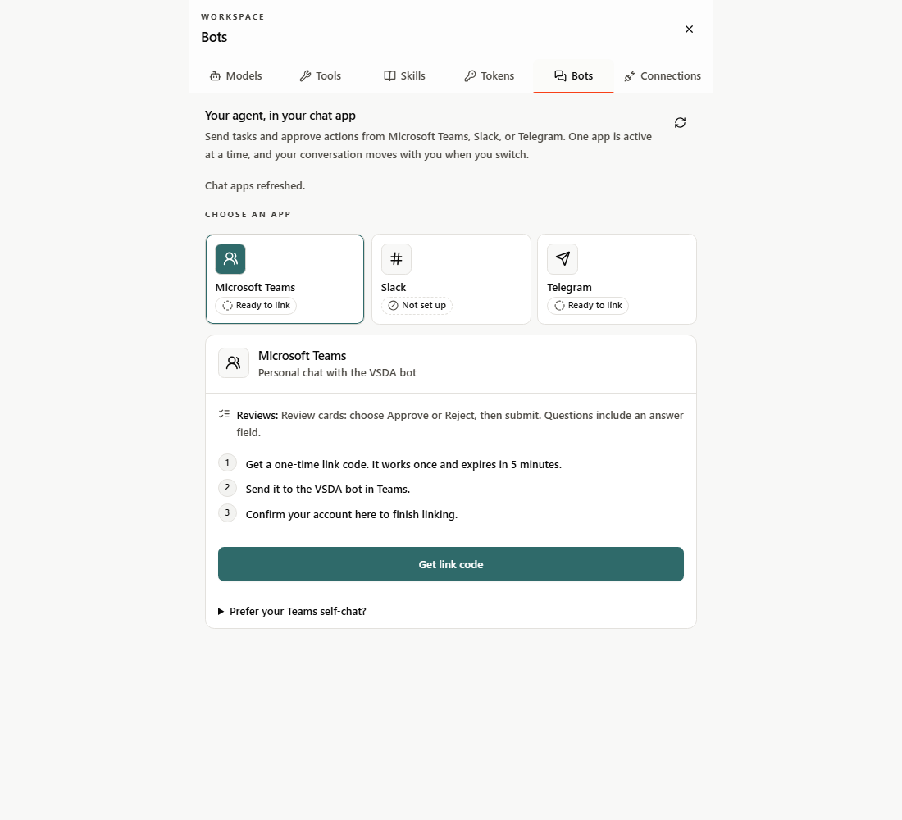
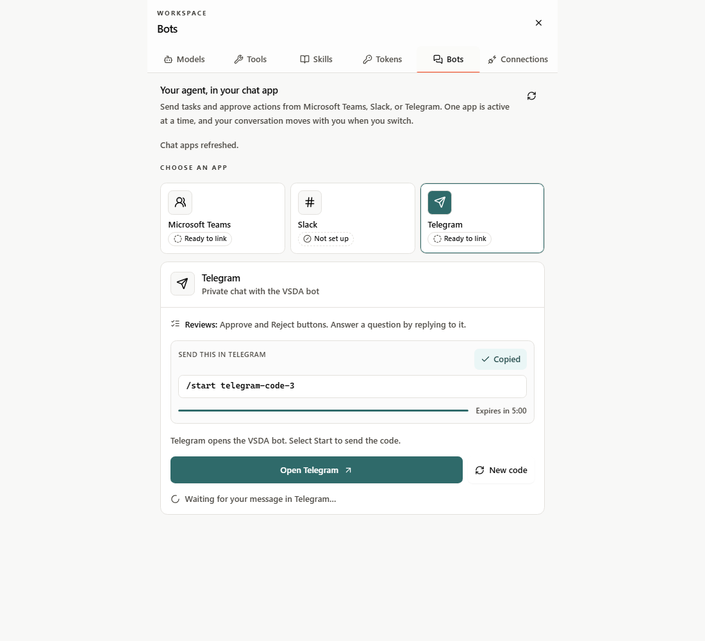
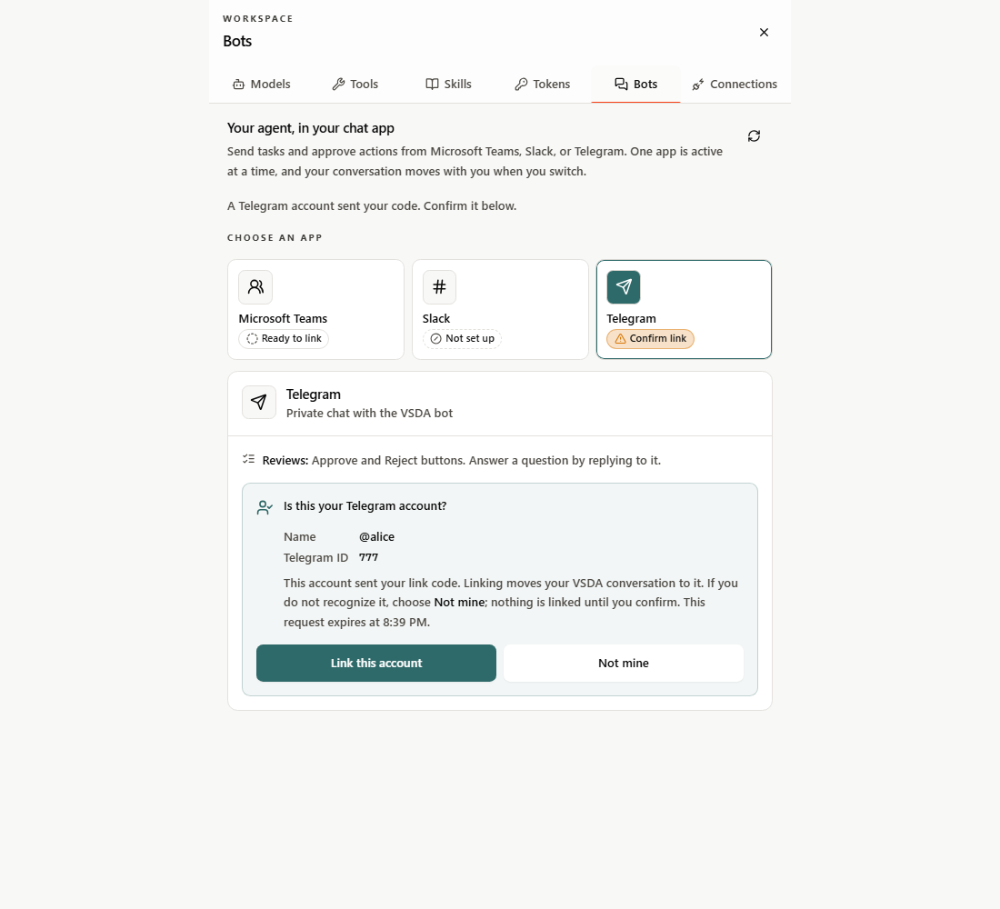
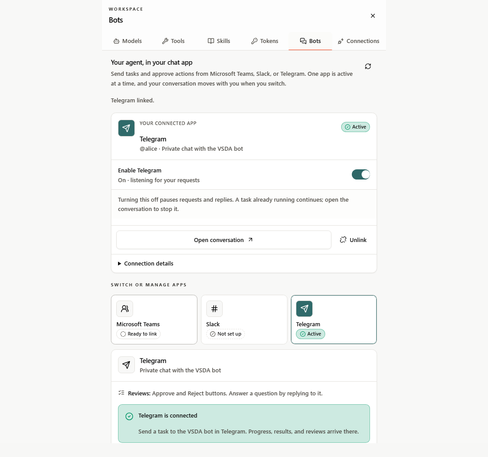
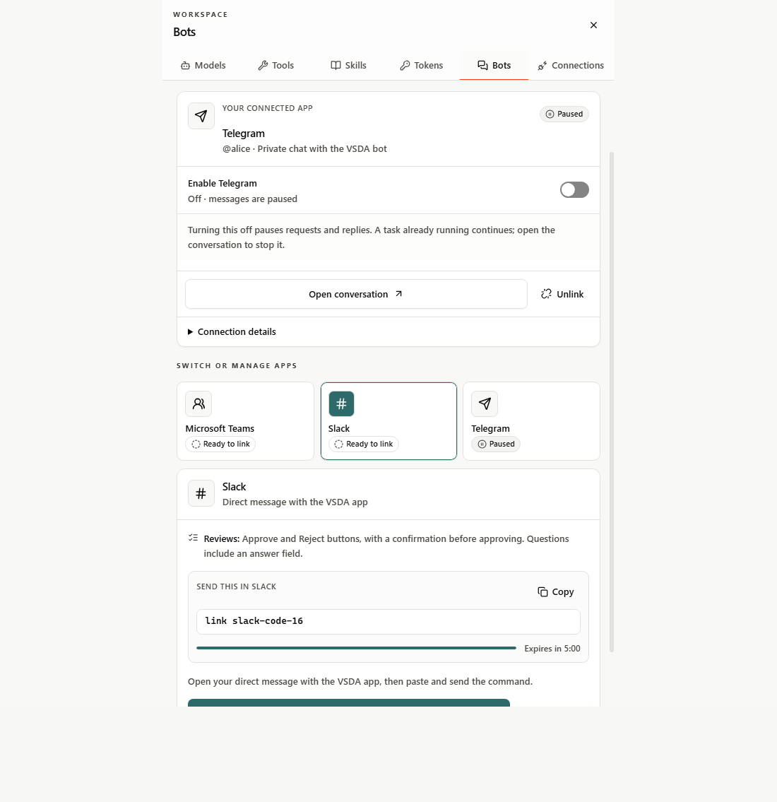
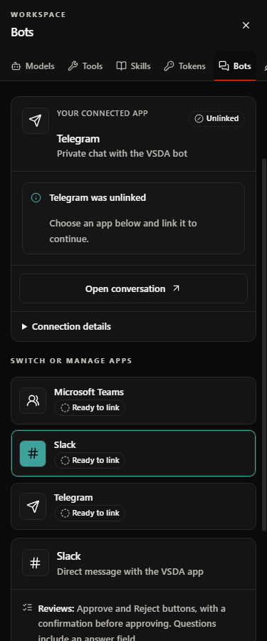
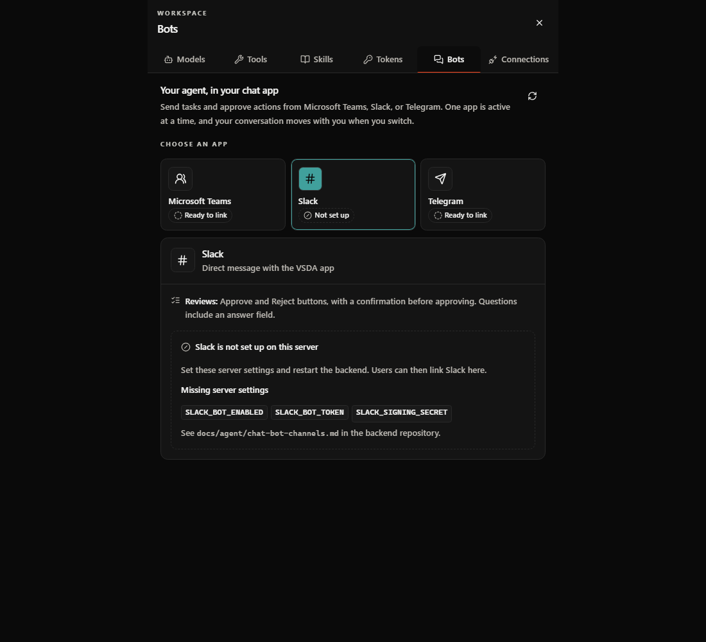

# Chat app settings (Workspace → Bots)

Open **Workspace → Bots** to talk to VSDA Deep Agent from **Microsoft Teams**,
**Slack**, or **Telegram**. The panel is available to every signed-in user. One
app is active per account; the conversation thread, any pending review, and
running tasks move with you when you switch. The retired **Teams** tab opens
this tab automatically.

| Area            | Behavior                                                                                                                                                                                                            |
| --------------- | ------------------------------------------------------------------------------------------------------------------------------------------------------------------------------------------------------------------- |
| Connected app   | Status badge, **Enable** switch (server-confirmed, never optimistic), autopilot, review-waiting, and needs-attention notices, **Open conversation**, **Unlink** with confirmation, and connection details.          |
| App picker      | A native radio group (arrow keys move between apps). Each app shows _Active_, _Paused_, _Linked before_, _Ready to link_, _Confirm link_, _Not set up_, or _Needs relink_ with an icon and text, never color alone. |
| App detail      | How reviews look in that app, then the one next step: link, turn on, or ask an administrator. Administrators also see which server settings are missing (names only).                                               |
| Link flow       | Steps, a one-time code with copy and a five-minute countdown, **Open in Teams/Slack/Telegram**, and automatic detection. If another app is on, **Turn off … and continue** pauses it first.                         |
| Teams self-chat | **Prefer your Teams self-chat?** keeps the Graph-token self-chat available as an alternative, including reconnection.                                                                                               |

## Linking

1. Choose an app. If it is not set up, ask an administrator to enable it.
2. Select **Get link code**. Teams and Telegram open with the command filled in;
   Slack needs the command pasted into the app's direct message.
3. The panel polls every three seconds (paused while the tab is hidden). When a
   chat account sends the code, the panel shows that account's name and ID.
4. Select **Link this account** to finish, or **Not mine** to discard it.
   Nothing is linked until you confirm, so a leaked or shared code cannot move
   your conversation to someone else's chat. The bot's messages also name your
   VSDA account. Codes are single use and expire after five minutes; **New
   code** replaces the previous code and any account waiting for confirmation.

Writes are never retried. After an ambiguous response the panel reads the saved
state back; if that read also fails, controls stay locked until **Refresh
status** succeeds. Busy-worker conflicts ask you to try again in a few seconds.
Server links are accepted only as HTTPS and open in a new tab without an opener.

Requires the backend channel API (`/api/chat-channels`) described in the
backend's `docs/agent/chat-bot-channels.md`. An older server's missing route is
shown as unavailable rather than as an unconnected account.

## Verification and screenshots

`tests/chat-channels.test.mjs` covers the API contract: paths and methods,
HTTPS-only links, schema rejection, error mapping, write retry suppression,
confirmation and discard of a redeemed account, link completion, and
clock-skew-tolerant code deadlines.

`tests/chat-channels-browser.test.mjs` runs the real Workspace and Bots
components against a mock API. It checks the retired-tab redirect, load-error
recovery, keyboard selection, link codes (copy, countdown, open link),
confirming a redeemed account and rejecting one with **Not mine**, a held and a conflicting toggle, switching apps,
unlinking with a confirmation dialog, administrator setup hints, no horizontal
overflow at 375 px, and WCAG 2.1 A/AA (axe-core) in light and dark themes with
reduced motion. Run it after `yarn build`:

```powershell
$env:CHAT_CHANNELS_BROWSER_TEST = "1"
# Optional: an existing Playwright module URL and Chromium executable.
$env:CHAT_CHANNELS_PLAYWRIGHT_MODULE = "file:///path/to/playwright/index.mjs"
$env:CHAT_CHANNELS_CHROMIUM = "C:\path\to\chrome-headless-shell.exe"
node --import tsx/esm --test tests/chat-channels-browser.test.mjs
```

These checks establish UI behavior only, not live Teams, Slack, or Telegram
delivery.














