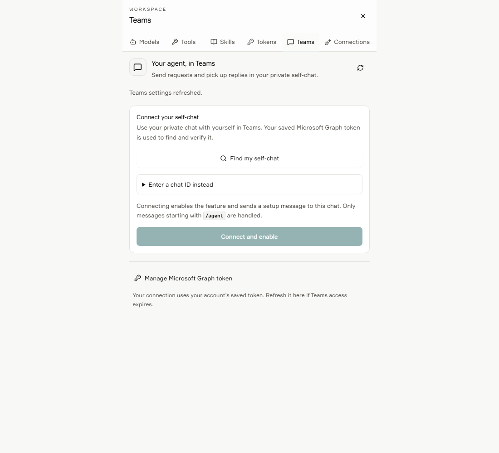
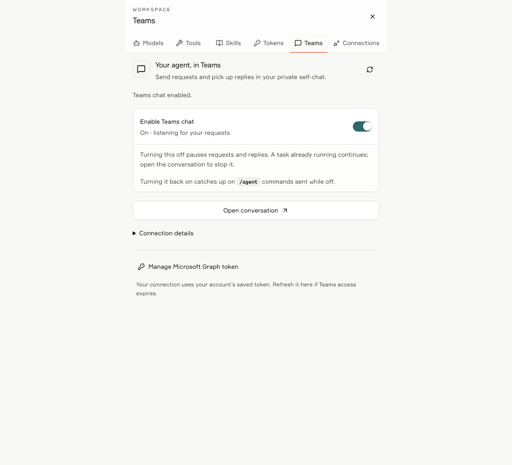
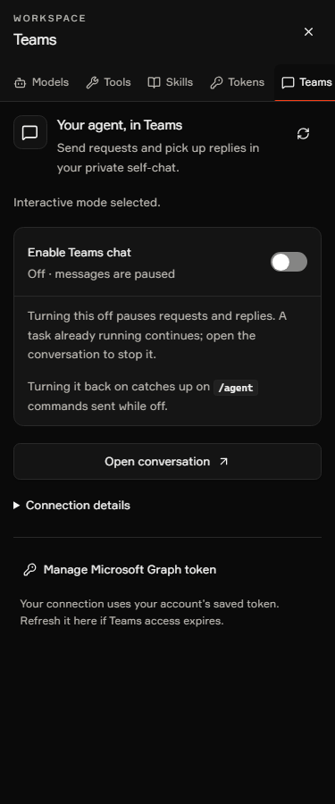

# Teams chat settings

Open **Workspace → Teams** to connect a private Teams self-chat and turn the
connection on or off. The panel is available to all signed-in users.

1. Use **Manage Microsoft Graph token** to open the existing Tokens panel at
   the Graph field if your token needs to be saved or refreshed.
2. Choose **Find my self-chat**, then select the discovered chat. Discovery is
   paginated; **Check more chats** reads the next page. You can also enter the
   self-chat ID directly.
3. **Connect and enable** explicitly opts into a setup greeting and creates an
   Interactive connection. The backend verifies self-chat ownership and access.
4. Use **Enable Teams chat** to change your saved preference. The switch waits
   for server confirmation and is locked during a request. Errors stay inline.
5. **Open conversation** opens the associated thread for reviews or cancellation.

Disabling pauses requests and replies, but does not cancel an active task.
Re-enabling catches up on `/agent` commands sent while disabled. An existing
Autopilot setting has a persistent notice and a **Use Interactive mode** action;
that action preserves the enabled preference. This panel does not enable
Autopilot or change its server-side role restrictions.

Server availability and the saved user preference are separate. If the operator
disables the service, a user can still turn their own preference off. Busy
worker conflicts ask the user to try again; the UI never retries writes. After
an ambiguous response, it reads the saved setting back. If that read also
fails, the control remains locked until **Refresh status** succeeds.

Requires the Teams backend endpoints introduced in
[backend PR #83](https://github.com/awbjcj/vsda-deep-agent/pull/83).
An older server's missing route is shown as unavailable, not as a new connection.

## Verification and screenshots

The API contract tests cover partial updates, Interactive setup, missing-route
handling, malformed responses, opaque cursors, and write retry suppression.
The browser fixture exercises the actual Workspace and Teams components with a
mock API and stubs for unrelated settings panels. It checks setup, pagination,
keyboard toggling, persistence, pending saves, conflicts, uncertain outcomes,
server availability, account changes, mobile/landscape layouts, and WCAG A/AA
checks in light and dark themes with reduced motion enabled.

Run the standard `yarn test`, `yarn lint`, `yarn format:check`, and `yarn build`.
To run the browser fixture after building, set `TEAMS_CHAT_BROWSER_TEST=1` and
run `node --import tsx/esm --test tests/teams-chat-browser.test.mjs`.
`TEAMS_CHAT_PLAYWRIGHT_MODULE` can point to an existing Playwright module URL.

These checks establish UI behavior only. They do not establish live Microsoft
365 self-chat support, token consent, or production deployment acceptance.

